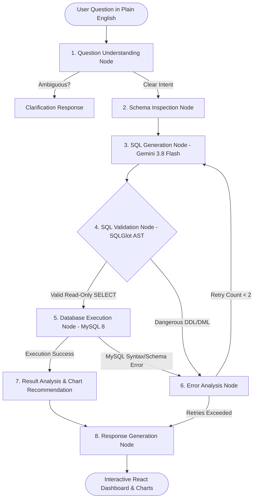
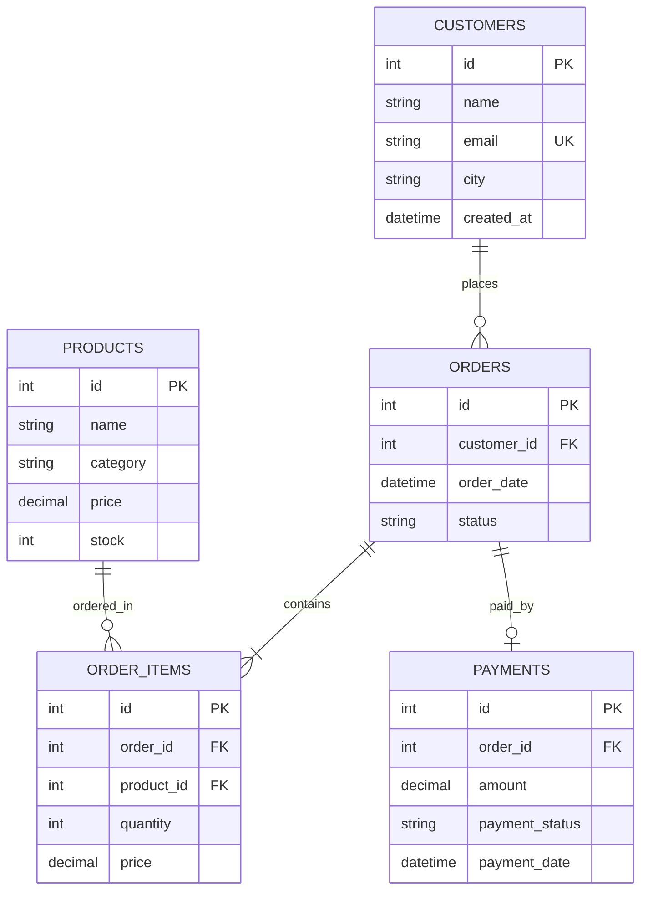

# AI SQL Database Analyst
> **Agentic AI-Powered Natural Language Relational Database Analytics Platform**

[](https://www.python.org/)
[](https://fastapi.tiangolo.com/)
[](https://www.langchain.com/langgraph)
[](https://ai.google.dev/)
[](https://react.dev/)
[](https://tailwindcss.com/)

---

## 📌 Project Overview
**AI SQL Database Analyst** is an enterprise-grade full-stack web application that allows users to interact with relational databases using natural language instead of manually writing complex SQL queries.

Unlike conventional Text-to-SQL wrappers, this application implements an **autonomous Agentic AI workflow powered by LangGraph and Google Gemini 3.8 Flash**. The agent dynamically inspects live database schemas, formulates multi-table queries, validates them through an AST security engine, executes only verified read-only SELECT statements, self-heals from runtime errors, computes business observations, and recommends interactive visualizations (Bar, Line, and Pie charts).

---

## 🏗️ System Architecture



---

## 🛡️ Key Software Engineering & Security Highlights

1. **AST-Based SQL Gatekeeper (SQLGlot):**
   - Strictly validates queries before they touch the database.
   - Enforces single statement execution (mitigating stacked query SQL injection).
   - Guarantees the query is purely an `exp.Select` or `exp.Union`.
   - Rejects `DROP`, `ALTER`, `DELETE`, `UPDATE`, `INSERT`, `TRUNCATE`, `GRANT`, `REVOKE`, and dangerous functions (`SLEEP`, `LOAD_FILE`, etc.).
   - Dynamically injects and caps `LIMIT` bounds to prevent memory exhaustion.
2. **Dedicated Read-Only Account (`analyst_readonly`):**
   - User-supplied queries execute through a dedicated non-administrative MySQL account granted solely `SELECT` permissions.
3. **AES-128 Credential Encryption at Rest:**
   - Database passwords are encrypted with `cryptography.fernet.Fernet` derived from the app's `SECRET_KEY` and decrypted strictly in memory.
4. **Self-Healing Agent Loop:**
   - If MySQL returns a runtime error (e.g. unknown column or join failure), the error message is fed back into Gemini's prompt to automatically correct the query up to 2 times without human intervention.
5. **No Hardcoded Schemas:**
   - Dynamically introspects live schemas using SQLAlchemy, discovering tables, data types, primary keys, and foreign keys.

---

## 📊 Sample Database Schema (`ecommerce_db`)



---

## 🚀 Quick-Start Guide (Windows PowerShell)

### 1. Backend Setup

```powershell
# Navigate to project root
cd d:\AI_SQL_DATABASE

# Activate virtual environment
.\.venv\Scripts\Activate.ps1

# Install backend dependencies
pip install -r requirements.txt

# Configure your environment in .env (Add your GEMINI_API_KEY and MySQL credentials)
# Start the FastAPI server
uvicorn backend.main:app --reload --port 8000
```
* Backend Swagger Docs: [http://127.0.0.1:8000/docs](http://127.0.0.1:8000/docs)

### 2. Frontend Setup

Open a **second PowerShell window**:

```powershell
cd d:\AI_SQL_DATABASE\frontend

# Install frontend dependencies
npm install

# Start Vite React development server
npm run dev
```
* Web Dashboard: [http://localhost:5173/](http://localhost:5173/)

### 3. Run Automated Tests

```powershell
pytest -v
```

---

## 📋 Roadmap & Implementation Checklist

- [x] **Phase 1: Project Initialization & Environment Setup**
- [x] **Phase 2: MySQL Sample E-Commerce Database (`ecommerce_db`)**
- [x] **Phase 3: Python & MySQL Connection Layer via SQLAlchemy 2.0**
- [x] **Phase 4: Dynamic Database Schema Inspection Tool**
- [x] **Phase 5: Gemini 3.8 Flash Integration & Structured SQL Generation**
- [x] **Phase 6: AST-Based SQL Validation & Read-Only Execution Engine**
- [x] **Phase 7: LangGraph Agentic Workflow & Self-Healing Retry Loop**
- [x] **Phase 8: Business Result Analysis & Data Visualization Selection**
- [x] **Phase 9: FastAPI REST Endpoints & Authentication**
- [x] **Phase 10: SaaS-Style React + Tailwind CSS Dashboard**
- [x] **Phase 11: Recharts Interactive Visualizations & Query History UI**
- [x] **Phase 12: Automated Test Suite (43 Unit & Integration Tests)**
- [x] **Phase 13: Docker & Docker Compose Multi-Container Orchestration**
- [x] **Phase 14: Comprehensive Project Documentation & Architecture Guides**
